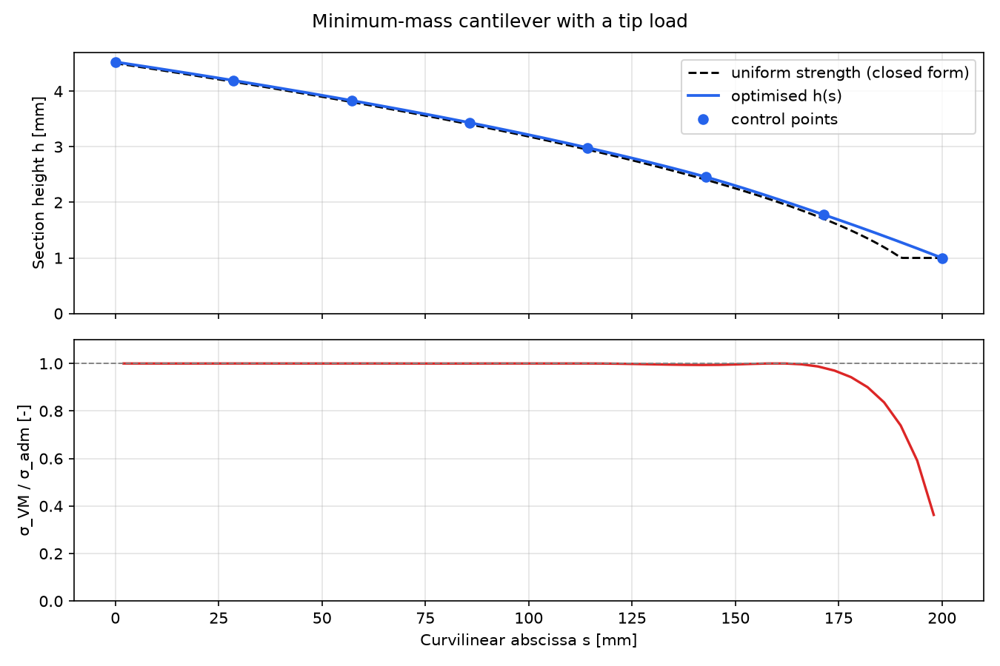

# beam-opt-framework

[](https://github.com/benitopezone-creator/beam-opt-framework/actions/workflows/ci.yml)
[](LICENSE)

A general-purpose **dimensional (size) optimization framework** for complex, strongly
curved 3-D beam structures: the cross-section of a curved beam varies along its arc
length and is optimized for minimum mass under stress, reaction-force and technological
constraints.

The structure is analysed either with the **built-in beam solver** (no ANSYS needed) or
with **ANSYS MAPDL** (BEAM188 / SHELL181 elements, large displacements) through PyMAPDL;
the problem definition is the same.



*Example 01: the optimised height of a tip-loaded cantilever follows the closed-form beam
of uniform strength (mass +1.7 % with 8 control points, 32 % lighter than the prismatic
beam).*

The framework is intentionally application-agnostic: any beam with fixed structural
sub-components can be optimized by describing it in a configuration (geometry, material,
boundary conditions) and, optionally, a custom cross-section and stress evaluator.
Nodes are always referred to **by name**; MAPDL numbering is decided by the framework.

---

## Repository layout

```
beam-opt-framework/
│
├── pyproject.toml
├── ROADMAP.md                  ← development plan (phases)
├── CHANGELOG.md
├── docs/                       ← design notes (Italian)
├── examples/                   ← ready-to-run cases with a known solution
├── tests/                      ← pytest suite (`mapdl` marker = needs ANSYS)
│   ├── fakes.py                ← FakeMapdl test double + numbering-free model description
│   └── data/                   ← regression scenario and golden reference
│
└── beam_opt/                   ← installable package
    ├── materials.py            ← Material (E, nu, rho, sigma_y) — no built-in materials
    ├── geometry/               ← BeamPath (arc-length spline), discretize(), BeamMesh
    ├── sections/               ← Section interface; rectangle, circle, tube, box
    ├── section_law.py          ← p(s) for named parameters, selectable interpolator
    ├── model/
    │   ├── components.py       ← OptimizableBeam, FixedBeam, FixedShell, StructuralModel
    │   ├── bcs.py              ← Clamp, Symmetry, ImposedDisplacement, RigidRegion, NodalForce
    │   └── builder.py          ← ModelBuilder: writes the model into an injected session
    ├── native.py               ← NativeSolver: built-in linear beam solver (no ANSYS)
    ├── solver.py               ← MAPDL solve() + mandatory convergence check
    ├── post/                   ← vectorised extraction (*VGET), stress evaluators
    ├── optimization/           ← OptimizationProblem, optimize() with selectable algorithm, history
    ├── report/                 ← textual report, plots
    └── session.py              ← MapdlSession: the only place that launches MAPDL
```

---

## Quick start

```bash
# 1. Clone
git clone https://github.com/benitopezone-creator/beam-opt-framework.git
cd beam-opt-framework

# 2. Create a virtual environment and install in editable mode
#    (Python 3.10–3.14: ansys-mapdl-core does not support newer versions yet)
python -m venv .venv
.venv\Scripts\activate          # Windows; on Linux/macOS: source .venv/bin/activate
pip install -e ".[dev]"

# 3. Run the first example (built-in solver, a few seconds)
python examples/01_cantilever/cantilever.py

# 4. Run the test suite
pytest -m "not mapdl"           # no ANSYS required
pytest -m mapdl                 # integration tests, require a licensed MAPDL
```

### Example: cantilever of uniform strength

[examples/01_cantilever](examples/01_cantilever) optimises the height of a tip-loaded
cantilever and compares the result with the closed-form beam of uniform strength
(parabolic profile, one third lighter than the prismatic beam):

```bash
python examples/01_cantilever/cantilever.py --save-plots results/cantilever
python examples/01_cantilever/cantilever.py --solver mapdl     # with a licensed MAPDL
```

A strongly curved 3-D frame example is planned — see [ROADMAP.md](ROADMAP.md).

---

## Usage

Minimum-mass cantilever with a tip load (units: mm, N, ton, s, MPa):

```python
import numpy as np
from beam_opt import (
    BeamPath,
    Clamp,
    Material,
    NativeSolver,
    NodalForce,
    OptimizableBeam,
    OptimizationProblem,
    StructuralModel,
    optimize,
)
from beam_opt.geometry import discretize
from beam_opt.report import print_report

path = BeamPath([[0.0, 0.0, 0.0], [200.0, 0.0, 0.0]])  # definition points [mm]
mesh = discretize(path, n_elem=50, anchors={"load": 150.0})  # node exactly at s = 150 mm
model = StructuralModel(
    beam=OptimizableBeam(mesh),
    material=Material(E=2.0e5, nu=0.3, rho=7.85e-9, sigma_y=355.0),
    bcs=[Clamp("start"), NodalForce("load", "FY", -20.0)],
)

problem = OptimizationProblem(
    NativeSolver(),  # or a MAPDL session, see below
    model,
    n_ctrl=6,  # design variables per section parameter
    bounds={"b": (2.0, 10.0), "h": (2.0, 20.0)},
    safety_factor=1.5,
    f_react_max=100.0,
    reaction_nodes=["start"],
)
result = optimize(problem, method="cobyla", max_evals=500)
print_report(result, problem)
```

### Choosing the solver

| | `NativeSolver()` | MAPDL session |
|---|---|---|
| Requires | nothing beyond the Python packages | licensed ANSYS MAPDL |
| Analysis | linear static | static with large displacements (`NLGEOM`) |
| Elements | 3-D Timoshenko beams | BEAM188, SHELL181 |
| Fixed shells | only inside a rigid region | yes |
| Cost per analysis | milliseconds | about a second |

```python
from beam_opt import MapdlSession

with MapdlSession(run_location="mapdl_tmp", nproc=4) as mapdl:
    problem = OptimizationProblem(mapdl, model, ...)  # same arguments
    result = optimize(problem)
```

The built-in solver uses the BEAM188 default element orientation and returns the internal
forces in the BEAM188 convention, so sections and stress evaluation are shared. It is
verified against closed-form solutions (`tests/test_native.py`: straight, statically
indeterminate and curved beams, rigid regions, symmetry); a direct comparison with MAPDL
results has not been run yet.

### Choosing the algorithm

The algorithm is one argument of `optimize`; the problem definition does not change.

| `method` | Family | Use it when |
|---|---|---|
| `"cobyla"` (default) | derivative-free, linear approximations on a simplex | general purpose, a few tens of variables |
| `"slsqp"` | gradient-based (SQP, finite differences) | smooth problem, good starting point: fastest and most accurate |
| `"nelder-mead"` | simplex search with penalised constraints | very few variables; slow |
| `"differential-evolution"` | evolutionary, population-based (genetic-algorithm family) | no good starting point, suspected local optima; costs thousands of FEM solutions |

```python
result = optimize(problem, "differential-evolution", max_evals=5000, seed=1)
result = optimize(problem, "slsqp", x0=result.x)  # refine the global search
```

All methods work on variables scaled to [0, 1] with the box bounds enforced, and return the
lightest *feasible* design evaluated. A non-converged FEM solution is recorded as a failed,
penalised design instead of stopping the run (`on_failure="raise"` restores the exception).

`OptimizationProblem(..., history_file="run.csv")` logs every FEM evaluation;
`beam_opt.optimization.best_design("run.csv")` returns the best design of an interrupted
run to restart from. New algorithms are added by registering a function in
`beam_opt.optimization.METHODS`.

The same configuration runs with any `n_elem`: the design variables (section-law control
points along *s*) and every name-based reference stay the same. See
[docs/anchors-e-discretizzazione.md](docs/anchors-e-discretizzazione.md) (Italian) for
anchors, curved paths and mesh-convergence studies.

---

## Extending

- **Cross-section shape:** `RectSection` (`b`, `h`), `CircSection` (`r`), `TubeSection`
  (`r`, `t`) and `BoxSection` (`b`, `h`, `t`) are available; choose one with
  `OptimizableBeam(mesh, section_factory=TubeSection.from_params)` and give the bounds of
  its parameters. For a new shape, subclass `beam_opt.sections.Section` (area, inertias,
  torsion, `stress_points()`, `define()` for `SECTYPE`/`SECDATA`, `from_params()`): the
  stress recovery follows from its check points, with no other change.
- **Different stress recovery:** subclass `beam_opt.post.StressEvaluator` and pass it as
  `OptimizationProblem(..., evaluator=MyEvaluator())`.
- **New boundary condition:** subclass `beam_opt.model.bcs.BoundaryCondition`
  (`node_names()` and `apply(mapdl, node_ids)`).

---

## Dependencies

| Package | Purpose |
|---|---|
| `ansys-mapdl-core` | MAPDL Python client (a MAPDL licence is needed only for the MAPDL solver) |
| `scipy` | optimisation algorithms |
| `numpy` | numerical operations |
| `matplotlib` | result plots (optional) |

---

## License

MIT — see [LICENSE](LICENSE).
