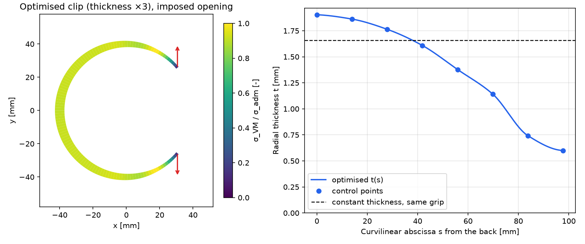

# beam-opt-framework

[](https://github.com/benitopezone-creator/beam-opt-framework/actions/workflows/ci.yml)
[](LICENSE)


**Size optimisation of curved 3-D beam structures in Python.** Describe a beam that winds
through space, choose a cross-section, and let the section dimensions vary along the beam
until the structure is as light as the stress, stiffness and reaction-force limits allow.

- **Runs without ANSYS.** A built-in 3-D beam solver is included; the same problem can be
  sent to **ANSYS MAPDL** (BEAM188 / SHELL181, large displacements) through PyMAPDL.
- **Reads and writes APDL.** Import an existing APDL script, optimise it, and write the
  optimum back as an APDL script — no ANSYS needed for either step.
- **Any cross-section.** Rectangle, circle, tube, box, I, ellipse, or your own outline:
  give a polygon and the framework computes its properties, torsion and stresses.
- **Choose the algorithm by name**: gradient-based, derivative-free, simplex or
  evolutionary.


*A helical tube propped by a strut, optimised under a stress and a deflection limit: the
optimiser thins the part that the strut relieves and puts the material just beyond it —
41 % lighter than the best constant-radius tube
([example 03](examples/03_helix)).*

---

## Install

```bash
git clone https://github.com/benitopezone-creator/beam-opt-framework.git
cd beam-opt-framework
python -m venv .venv
.venv\Scripts\activate            # Windows; on Linux/macOS: source .venv/bin/activate
pip install -e ".[dev]"           # add ",mapdl" to also install the ANSYS MAPDL client
```

Python 3.10 or newer. The only dependencies are NumPy, SciPy and Matplotlib.

```bash
python examples/03_helix/helix.py     # a first run, a few seconds
pytest -m "not mapdl"                 # the test suite, no ANSYS required
```

## A minimal problem

Minimum-mass cantilever with a tip load (units: mm, N, ton, s, MPa):

```python
from beam_opt import (
    BeamPath,
    Clamp,
    Material,
    NativeSolver,
    NodalForce,
    OptimizableBeam,
    OptimizationProblem,
    StructuralModel,
    optimize,
)
from beam_opt.geometry import discretize
from beam_opt.report import print_report

path = BeamPath([[0.0, 0.0, 0.0], [200.0, 0.0, 0.0]])  # centre line through points
mesh = discretize(path, n_elem=50, anchors={"load": 150.0})  # a node exactly at s = 150
model = StructuralModel(
    beam=OptimizableBeam(mesh),  # rectangular section b x h
    material=Material(E=2.0e5, nu=0.3, rho=7.85e-9, sigma_y=355.0),
    bcs=[Clamp("start"), NodalForce("load", "FZ", -20.0)],
)
problem = OptimizationProblem(
    NativeSolver(),
    model,
    n_ctrl=6,  # control points per parameter
    bounds={"b": (2.0, 10.0), "h": (2.0, 20.0)},
    safety_factor=1.5,
    f_react_max=100.0,
    reaction_nodes=["start"],
)
result = optimize(problem, method="slsqp")
print_report(result, problem)
```

Nodes are always referred to **by name** (`"start"`, `"end"`, your own anchors), never by
number, and the design variables are the values of each section parameter at a few control
points along the arc length: the same problem runs unchanged with 10 or 400 elements.

## Examples

| | |
|---|---|
| [**01 — Cantilever of uniform strength**](examples/01_cantilever)<br>Validation against the closed-form optimum: mass within 1.7 %, 32 % lighter than the prismatic beam. |  |
| [**02 — C-shaped spring clip**](examples/02_c_spring)<br>A planar curved beam opened by an *imposed displacement*, with a minimum grip force. No constant thickness is admissible; the optimised one is, and is 16 % lighter. |  |
| [**03 — Helical tube beam**](examples/03_helix)<br>Bending about two axes, torsion and shear together, statically indeterminate; stress and deflection limits. 41 % lighter. |  |
| [**04 — From an APDL script to an optimised APDL script**](examples/04_apdl_arch)<br>A clamped arch written in APDL is read, optimised (60 % lighter) and written back. | `arch.inp` → `arch_optimised.inp` |

## What you can model

**Structure.** One optimisable beam along a curved path, plus fixed beams and shells, with
clamps, symmetry planes, imposed displacements, nodal forces and rigid regions.

**Cross-sections.**

| Section | Parameters | MAPDL |
|---|---|---|
| `RectSection` | `b`, `h` | `RECT` |
| `CircSection` | `r` | `CSOLID` |
| `TubeSection` | `r`, `t` | `CTUBE` |
| `BoxSection` | `b`, `h`, `t` | `HREC` |
| `ISection` | `b`, `h`, `tw`, `tf` | `I` |
| `EllipseSection` | `a`, `b` | `ASEC` |
| `polygon_shape(vertices)` | `scale` | `ASEC` |
| `SectionShape.from_properties(...)` | `scale` | `ASEC` |

Any parameter can be kept constant instead of optimised:
`OptimizableBeam(mesh, section_factory=ISection.with_fixed(tw=5.0, tf=8.0))`.

A custom shape is an outline:

```python
from beam_opt import polygon_shape

shape = polygon_shape([(0, 0), (20, 0), (20, 12), (12, 12), (12, 6), (8, 6), (8, 12), (0, 12)])
beam = OptimizableBeam(mesh, section_factory=shape)  # design variable: "scale"
```

Area, centroid, inertias (including the product of inertia) come from the outline; the
Saint-Venant torsion problem is solved numerically once; the stresses follow from the
internal forces at check points along the outline.

**Constraints.** Von Mises stress in every element, maximum and minimum reaction force,
displacement or rotation limits at named nodes, bounds on every dimension.

## Choosing the solver

| | `NativeSolver()` | MAPDL session |
|---|---|---|
| Requires | nothing beyond the Python packages | licensed ANSYS MAPDL, `pip install -e ".[mapdl]"` |
| Analysis | linear static | static with large displacements (`NLGEOM`) |
| Elements | 3-D Timoshenko beams | BEAM188, SHELL181 |
| Fixed shells | only inside a rigid region | yes |
| Cost per analysis | milliseconds | about a second |

```python
from beam_opt import MapdlSession

with MapdlSession(run_location="mapdl_tmp", nproc=4) as mapdl:
    problem = OptimizationProblem(mapdl, model, ...)  # same arguments
    result = optimize(problem)
```

The built-in solver uses the BEAM188 default element orientation and internal-force
convention, so sections and stress evaluation are shared between the two.

## Choosing the algorithm

| `method` | Family | Use it when |
|---|---|---|
| `"slsqp"` | gradient-based (SQP, finite differences) | smooth problem: fastest and most accurate |
| `"cobyla"` (default) | derivative-free, linear approximations | general purpose, noisy responses |
| `"differential-evolution"` | evolutionary, population-based (genetic-algorithm family) | no good starting point, suspected local optima; thousands of analyses |
| `"nelder-mead"` | simplex search with penalised constraints | very few variables; slow |

```python
result = optimize(problem, "differential-evolution", max_evals=5000, seed=1)
result = optimize(problem, "slsqp", x0=result.x)  # refine the global search
```

Every method returns the lightest *feasible* design it evaluated, respects a hard budget
of analyses (`max_evals`), and survives a failed analysis. With
`OptimizationProblem(..., history_file="run.csv")` every analysis is logged and an
interrupted run can restart from `beam_opt.optimization.best_design("run.csv")`. New
algorithms are registered in `beam_opt.optimization.METHODS`.

## APDL import and export

```python
from beam_opt.apdl import read_apdl, write_apdl

imported = read_apdl("model.inp", sigma_y=355.0)  # no ANSYS involved
problem = imported.problem(
    NativeSolver(),
    n_ctrl=6,
    bounds={"b": (5, 30), "h": (5, 30)},
    safety_factor=1.5,
    f_react_max=1e4,
)
result = optimize(problem, "slsqp", x0=imported.x0(problem))
write_apdl(problem.model, problem.law_from_x(result.x), "model_optimised.inp")
```

The beam to optimise is marked in the script with the element component `OPT_BEAM`. The
reader interprets parameters, expressions, `*DO` loops, nodes, elements, sections,
selections, constraints and loads, and reports the line of anything it does not support.
See [docs/apdl.md](docs/apdl.md) (Italian) for the list of commands and the limits.

## Extras

Beyond the core, `beam_opt.extras` collects tools developed on top of the framework and
kept separate from it: objectives other than the mass (stiffness, peak stress, fatigue
life), low-cycle fatigue with load spectra (Miner's rule, rainflow counting), independent
load cases and Pareto fronts. They plug in through generic parameters of
`OptimizationProblem` and are not needed for minimum-mass design.

```python
from beam_opt.extras import Compliance

problem = OptimizationProblem(NativeSolver(), model, ..., objective=Compliance(), mass_max=150.0)
```

Examples in [examples/extras](examples/extras), theory in [docs/extras.md](docs/extras.md)
(Italian). The extras are tested (`tests/extras`) but newer and less established than the
core.

## Verification

The suite (`pytest -m "not mapdl"`, 330+ tests) checks the framework against closed-form
results: deflections and reactions of straight, statically indeterminate and curved beams
(Castigliano), torsion constants and stresses of every section, the beam of uniform
strength, and the round trip through APDL. Continuous integration runs it on every push.

**Not yet verified:** a direct comparison between the built-in solver and MAPDL on the same
model. The MAPDL path is exercised by tests marked `mapdl`, which need a licensed
installation.

## Documentation

- [docs/teoria.md](docs/teoria.md) — formulation, solver, stress recovery, assumptions (Italian)
- [docs/apdl.md](docs/apdl.md) — APDL import/export and custom sections (Italian)
- [docs/extras.md](docs/extras.md) — extras: other objectives, fatigue, load cases (Italian)
- [docs/anchors-e-discretizzazione.md](docs/anchors-e-discretizzazione.md) — anchors, curved paths, mesh studies (Italian)
- [CHANGELOG.md](CHANGELOG.md), [ROADMAP.md](ROADMAP.md)

## Repository layout

```
beam_opt/
├── geometry/        BeamPath (arc-length spline), discretize(), BeamMesh
├── sections/        Section interface and shapes, user-defined shapes
├── section_law.py   section parameters along the arc length
├── model/           components, boundary conditions, MAPDL model builder
├── native.py        built-in linear beam solver
├── solver.py        MAPDL solution with convergence check
├── session.py       MAPDL session (the only place that launches MAPDL)
├── post/            result extraction, stress evaluation
├── optimization/    problem, selectable algorithms, history
├── apdl.py          APDL import and export
├── report/          text report and plots
└── extras/          beyond the core: other objectives, fatigue, load cases, Pareto fronts
examples/            four ready-to-run cases; extras/ for the extras
tests/               pytest suite; extras/ for the extras
docs/                theory and guides
```

## Limits

Linear-elastic material and elastic stress check (no buckling, fatigue or stress
concentrations); one optimisable beam per model; the built-in solver is linear and does
not model deformable shells; shear stresses use the Jourawski formula.

## Citing

If you use this framework in academic work, please cite it using the metadata in
[CITATION.cff](CITATION.cff).

## License

MIT — see [LICENSE](LICENSE).
