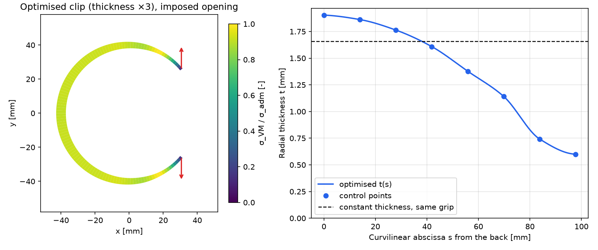

# Esempio 02 — Molla a C aperta a spostamento imposto

Una trave piana fortemente curva caricata da uno **spostamento imposto**: è il caso tipico
di clip, fermagli e archetti elastici, che vengono allargati di una quantità nota al
montaggio e devono poi stringere con una forza minima senza snervarsi.



## Problema

| Grandezza | Valore |
|---|---|
| Raggio della linea d'asse | 40 mm |
| Estensione angolare | 280° (punte a ±40°) |
| Larghezza fuori piano (costante) | 10 mm |
| Apertura imposta tra le punte | 12 mm |
| Forza di presa richiesta | tra 20 e 60 N |
| Materiale | acciaio, `σ_y` = 390 MPa, `FS` = 1,5 |
| Variabile di progetto | spessore radiale `t(s)`, tra 0,6 e 4 mm |

Si modella metà clip, con un piano di simmetria sul dorso. Obiettivo: massa minima.

## Perché è interessante

Con un carico in spostamento l'intuizione si rovescia: una clip **più spessa** è più rigida
e quindi **più sollecitata**, una più sottile stringe meno. I due vincoli tirano in
direzioni opposte.

- A spessore costante, la clip più sottile che raggiunge i 20 N di presa ha 1,66 mm di
  spessore e lavora al **125 %** della tensione ammissibile: non esiste una soluzione a
  spessore costante.
- Lasciando variare lo spessore, l'ottimizzatore lo porta a 1,9 mm sul dorso (dove il
  momento è massimo) e a 0,6 mm in punta: tensione al 100 %, presa di 20 N e **16 % di
  massa in meno**.

## Esecuzione

```bash
python examples/02_c_spring/c_spring.py --save-plots results/c_spring
```

Opzioni: `--method`, `--n-elem`, `--n-ctrl`, `--solver mapdl`, `--export-apdl file.inp`
(scrive la clip ottimizzata come script APDL).

## Note di modellazione

- Con l'orientamento predefinito di BEAM188 l'asse locale `y` di ogni elemento giace nel
  piano della clip: lo spessore radiale è quindi la dimensione `b` della sezione, e la
  larghezza fuori piano è `h` (tenuta costante con `RectSection.with_fixed(h=...)`).
- La forza di presa è la reazione sul nodo a cui è imposto lo spostamento
  (`reaction_nodes=["end"]`), limitata inferiormente da `f_react_min`.
- `tests/test_examples_curved.py` confronta la forza di una clip a spessore costante con
  la soluzione di Castigliano (scarto inferiore allo 0,5 %).
