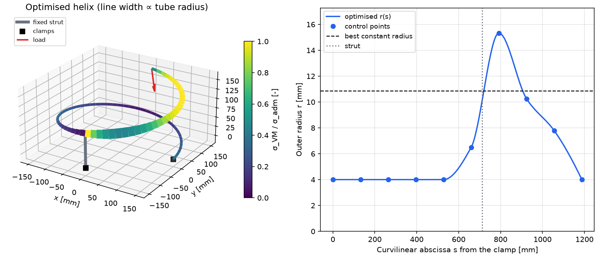

# Esempio 03 — Trave elicoidale nello spazio con puntone

Una trave che segue un'elica: ogni elemento lavora contemporaneamente a flessione su due
assi, a torsione e a taglio. È il caso in cui una trave curva nello spazio si distingue di
più da una trave rettilinea, ed è iperstatico per la presenza di un puntone.



## Problema

| Grandezza | Valore |
|---|---|
| Raggio dell'elica | 150 mm |
| Passo | 120 mm per giro |
| Sviluppo | 1,25 giri (circa 1190 mm) |
| Sezione | tubo, spessore costante 1,5 mm |
| Vincoli | incastro alla base; puntone verticale fisso a 0,75 giri |
| Carico all'estremo libero | 250 N verso il basso + 60 N laterali |
| Materiale | lega di alluminio, `σ_y` = 240 MPa, `FS` = 1,5 |
| Variabile di progetto | raggio esterno `r(s)`, tra 4 e 16 mm |

Obiettivo: massa minima. Vincoli: tensione di von Mises e freccia verticale dell'estremo
libero non superiore a 35 mm.

## Risultato

Con le impostazioni predefinite (SLSQP, 80 elementi, 10 punti di controllo):

| | Raggio costante | Ottimizzato |
|---|---|---|
| Raggio esterno | 10,9 mm | da 4,0 a 15,3 mm |
| Massa | 305,9 g | 179,6 g (**−41 %**) |
| Tensione / ammissibile | — | 100 % |
| Freccia dell'estremo | — | 35,0 mm (al limite) |

Il risultato ha una lettura fisica chiara: il carico viene portato a terra dal puntone,
quindi il tratto tra incastro e puntone scende al raggio minimo, mentre il materiale si
concentra subito oltre il puntone, dove lo sbalzo ha momento e torsione massimi.

## Esecuzione

```bash
python examples/03_helix/helix.py --save-plots results/helix
python examples/03_helix/helix.py --method differential-evolution --max-evals 6000 --seed 1
```

Opzioni: `--n-elem`, `--n-ctrl`, `--solver mapdl`, `--export-apdl file.inp`.

## Note di modellazione

- La linea d'asse è una spline per i punti dell'elica (`BeamPath`); il puntone si attacca a
  un *anchor* (`"prop"`) posto all'ascissa voluta, quindi resta al suo posto con qualsiasi
  numero di elementi.
- Lo spessore del tubo è fissato con `TubeSection.with_fixed(t=1.5)`; il puntone è un
  `FixedBeam`, non ottimizzato.
- Il vincolo di rigidezza è `displacement_limits=[("end", "UZ", 35.0)]`.
