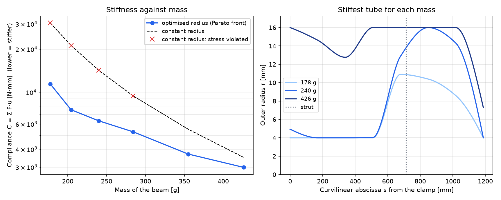

# Esempio 05 — Rigidezza contro massa per l'elica

L'elica dell'esempio 03 viene progettata per la **rigidezza** invece che per la massa:
minima cedevolezza (il lavoro dei carichi, `C = Σ F·u`) con un budget di massa, mantenendo
il vincolo di tensione di von Mises. Facendo variare il budget si ottiene il fronte di
Pareto massa-rigidezza.



## Problema

| Grandezza | Valore |
|---|---|
| Struttura | elica dell'esempio 03 (1,25 giri, puntone fisso, carico all'estremo libero) |
| Obiettivo | cedevolezza `C = Σ F·u` (più bassa = più rigida) |
| Vincoli | tensione di von Mises (FS = 1,5), massa ≤ budget |
| Budget | da 1 a 2,4 volte la massa minima ammissibile (177,6 g) |
| Confronto | tubo a raggio costante della stessa massa |

## Risultato

| Massa [g] | Cedevolezza ottimizzata [N·mm] | Raggio costante [N·mm] | Più rigida del | Raggio costante ammissibile? |
|---|---|---|---|---|
| 177,6 | 11 419 | 30 462 | 62 % | no |
| 204,2 | 7 548 | 21 242 | 65 % | no |
| 239,7 | 6 322 | 14 243 | 56 % | no |
| 284,1 | 5 293 | 9 437 | 44 % | no |
| 355,2 | 3 700 | 5 513 | 33 % | sì |
| 426,2 | 2 989 | 3 511 | 15 % | sì |

Due osservazioni:

- **Fino a circa 300 g nessun tubo a raggio costante è ammissibile**: viola il vincolo di
  tensione. Il progetto ottimizzato lo è, e a parità di massa è da 2 a 3 volte più rigido.
- Il guadagno cala quando il budget cresce, perché il raggio arriva ovunque al limite
  tecnologico di 16 mm e i due progetti tendono a coincidere.

Come nell'esempio 03, il materiale si concentra oltre il puntone. Con budget ampi però
l'ottimizzatore irrigidisce anche il tratto vicino all'incastro, che a massa minima era al
raggio minimo.

## Esecuzione

```bash
python examples/05_stiffness_pareto/stiffness_pareto.py --save-plots results/stiffness
```

Circa 10 secondi con il solutore interno.
