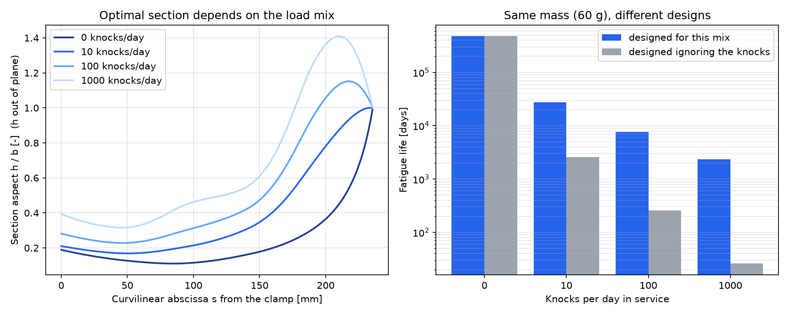

# Extra — Staffa curva con due casi di carico indipendenti

Una staffa a quarto di cerchio, incastrata a un estremo, porta all'altro estremo due
carichi che **non agiscono insieme**:

- un carico nel proprio piano, frequente (servizio, da zero al massimo);
- un carico fuori dal piano, più raro (urti laterali, alterni), che la torce anche.

La sezione rettangolare è libera in entrambe le dimensioni: la larghezza `b`, nel piano,
resiste al carico di servizio; l'altezza `h`, fuori piano, resiste agli urti. Si cerca la
massima vita a fatica a massa data (60 g), con il danno di Miner sommato sui due casi.



## Problema

| Grandezza | Valore |
|---|---|
| Raggio della linea d'asse | 150 mm |
| Carico di servizio (nel piano) | 300 N, 1000 cicli al giorno, R = 0 |
| Urti (fuori piano) | 40 N, da 0 a 1000 al giorno, R = −1 |
| Materiale | acciaio; curva deformazione-vita come nell'esempio extra della clip (indicativa) |
| Variabili | `b(s)` e `h(s)`, tra 2 e 20 mm, 6 punti di controllo ciascuna |
| Obiettivo | massima vita a fatica in giorni, massa 60 g |

## Risultato

Vita in giorni del progetto ottimizzato per un mix (righe) usato con un mix (colonne):

| Ottimizzato per \ usato con | 0 urti/giorno | 10 | 100 | 1000 |
|---|---|---|---|---|
| 0 urti/giorno | **4,77·10⁵** | 2,59·10³ | 260 | 26 |
| 10 | 3,13·10⁴ | **2,75·10⁴** | 3,40·10³ | 348 |
| 100 | 8,87·10³ | 8,73·10³ | **7,66·10³** | 1,08·10³ |
| 1000 | 2,66·10³ | 2,66·10³ | 2,63·10³ | **2,33·10³** |

- **La forma ottima dipende dal mix**: all'incastro il rapporto `h/b` passa da 0,19
  (nessun urto) a 0,39 (1000 urti al giorno). Più urti, più materiale fuori dal piano.
- **Ogni progetto è il migliore per il proprio mix**: in ogni colonna il valore più alto
  è sulla diagonale. È anche una verifica che l'ottimizzazione arriva all'ottimo.
- **Ignorare il carico raro costa molto**: con 10, 100 e 1000 urti al giorno, il progetto
  che non ne tiene conto dura rispettivamente 11, 30 e 90 volte meno di quello che li
  considera, pur avendo la stessa massa.

È la differenza con l'esempio extra della clip ([lcf_clip](../lcf_clip)): lì un unico schema di carico scalato rende la forma
ottima indipendente dallo spettro; qui i due casi sollecitano la sezione in modi diversi,
e conta quanto spesso si presenta ciascuno.

## Esecuzione

```bash
python examples/extras/bracket_load_cases/bracket.py --save-plots results/bracket
```

Circa 30 secondi con il solutore interno (16 ottimizzazioni e valutazioni incrociate).

## Note

- Il danno è sommato caso per caso: i cicli che nascerebbero dalla transizione tra un
  caso e l'altro (ad esempio un urto mentre la staffa è carica) non sono contati. È
  l'ipotesi standard della somma per casi, accettabile quando i casi non si sovrappongono
  nel tempo.
- Dentro ogni caso la tensione è quella di von Mises nel punto più sollecitato
  dell'elemento; casi diversi possono avere punti critici diversi.
