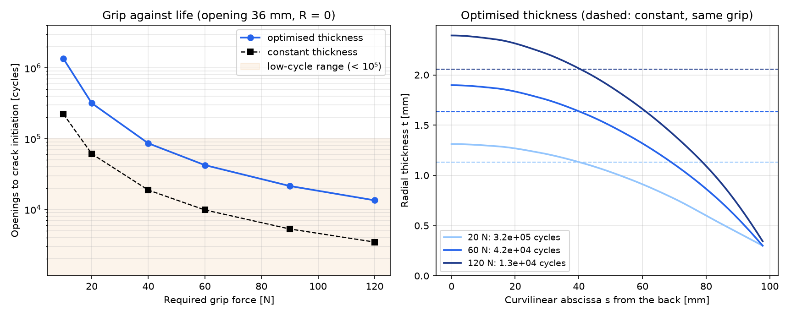

# Extra — Fatica oligociclica di una clip a scatto: presa contro vita

La clip a C dell'esempio 02 ([examples/02_c_spring](../../02_c_spring)) viene aperta e rilasciata a ogni utilizzo e deve continuare a
stringere il pezzo che trattiene. L'apertura è grande, quindi la clip **snerva
localmente**: il criterio di progetto non è più "tensione sotto lo snervamento", ma **il
numero di aperture prima che nasca una cricca**.



## Problema

| Grandezza | Valore |
|---|---|
| Geometria e materiale | quelli dell'esempio 02 ([examples/02_c_spring](../../02_c_spring)) (raggio 40 mm, larghezza 10 mm) |
| Apertura a ogni utilizzo | 36 mm, ciclo da zero al massimo (R = 0) |
| Curva deformazione-vita | acciaio al carbonio medio: σ'_f = 930 MPa, b = −0,095, ε'_f = 0,26, c = −0,47, K' = 1258 MPa, n' = 0,208 (valori indicativi) |
| Correzione della tensione media | Smith-Watson-Topper |
| Variabile di progetto | spessore radiale `t(s)`, tra 0,3 e 6 mm |
| Obiettivo | massima vita a fatica dell'elemento più critico |
| Vincolo | forza di presa ≥ F_min |

Non c'è vincolo statico di tensione: lo snervamento locale è accettato, e a governare è
la vita.

## Perché è interessante

Con un carico in spostamento imposto, una clip più rigida stringe di più **e** si
deforma di più, quindi dura meno. Presa e vita sono obiettivi in conflitto: l'esempio
traccia il fronte di Pareto con il metodo epsilon-constraint, cioè la vita massima per
ogni presa minima richiesta.

| Presa [N] | Vita ottimizzata | Vita a spessore costante | Guadagno | ε_a [%] | ε plastica [%] |
|---|---|---|---|---|---|
| 10 | 1,35·10⁶ | 2,23·10⁵ | 6,1× | 0,10 | 0,011 |
| 20 | 3,18·10⁵ | 6,11·10⁴ | 5,2× | 0,14 | 0,025 |
| 40 | 8,6·10⁴ | 1,88·10⁴ | 4,6× | 0,19 | 0,054 |
| 60 | 4,23·10⁴ | 9,84·10³ | 4,3× | 0,22 | 0,080 |
| 90 | 2,15·10⁴ | 5,30·10³ | 4,1× | 0,27 | 0,115 |
| 120 | 1,35·10⁴ | 3,46·10³ | 3,9× | 0,31 | 0,148 |

A parità di forza di presa, lo spessore variabile moltiplica la vita **da 4 a 6 volte**.
L'ottimizzatore ispessisce il dorso, dove il momento è massimo, e assottiglia la punta,
così da distribuire lo stesso danno lungo tutta la clip. Per prese elevate si è in pieno
campo oligociclico (vite di 10³-10⁴ cicli, deformazione plastica comparabile con quella
elastica).

## Vita in servizio: spettro di carico e regola di Miner

Nell'uso reale le aperture non sono tutte uguali. L'esempio genera la storia di una
giornata (40 utilizzi, aperture tra il 50 % e il 100 % di quella massima, un utilizzo su
quattro senza rilascio completo), la riduce a uno spettro con il **conteggio rainflow**
(ASTM E1049) e somma il danno con la **regola di Miner**. La vita risulta in giorni.

Per la clip con presa di 60 N:

| Progetto | Vita in servizio |
|---|---|
| Ottimizzato per aperture complete | 4675 giorni (12,8 anni) |
| Ottimizzato per lo spettro giornaliero | 4675 giorni (12,8 anni) |
| Spessore costante | 988 giorni (2,7 anni) |

I due progetti ottimizzati hanno la stessa vita, e nella nostra esecuzione anche la stessa
forma (scarto relativo 5·10⁻⁷, partendo dallo stesso punto). Non è un caso: con un
**unico schema di carico scalato**, rendere minimo il danno peggiore equivale a rendere
minima la tensione peggiore, qualunque sia la curva di fatica, quindi il valore ottimo non
dipende dallo spettro. Lo spettro cambia la vita in giorni, non il progetto ottimo. La
forma è determinata in modo univoco solo dove la clip è critica: con versioni diverse delle
librerie numeriche gli spessori possono differire di qualche percento altrove (fino al
4 % su Python 3.12 nella CI), a parità di vita. La forma
dipenderebbe dallo spettro con più casi di carico indipendenti, ad esempio forze in
direzioni diverse in momenti diversi: è il prossimo passo naturale.

Il 78,5 % del danno dell'elemento critico viene dalle aperture oltre l'80 %, che sono
solo 15 su 40 al giorno: con una curva di fatica così ripida contano soprattutto i cicli
ampi.

## Esecuzione

```bash
python examples/extras/lcf_clip/lcf_clip.py --save-plots results/lcf_clip
```

Circa 40 secondi con il solutore interno.

## Note

- Le costanti deformazione-vita sono indicative: per un progetto reale servono quelle del
  materiale e del trattamento effettivi.
- Il modello è lineare: la plasticità entra solo nel punto critico, tramite la regola di
  Neuber, e non redistribuisce le sollecitazioni nella clip. È l'ipotesi standard
  dell'approccio locale in deformazione, valida finché lo snervamento resta localizzato.
- La teoria è in [docs/extras.md](../../../docs/extras.md).
